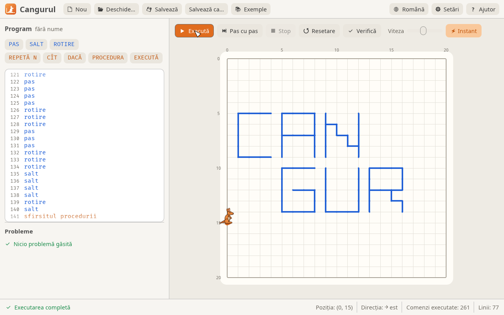
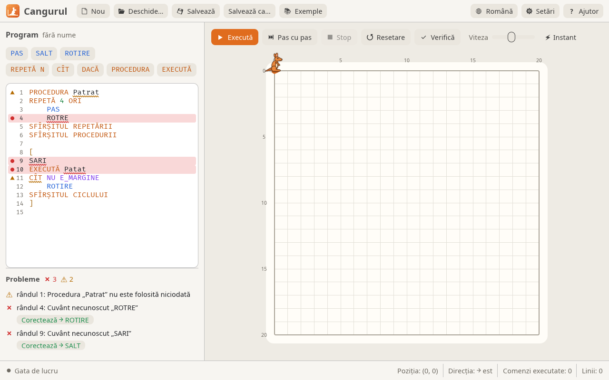

Cangurul stă pe un câmp cu grilă. Elevul scrie un program cu comenzi simple — `PAS`, `SALT`, `ROTIRE`, cicluri, condiții și proceduri — iar cangurul îl execută, desenând linii pe câmp. Din câteva comenzi ies litere, pătrate, spirale și chiar numele cangurului. Cangurul 3 este rescris în Rust după programul „Cangurul” (versiunea 2), iar fișierele `.cng` vechi se deschid și rulează fără modificări.



**[Descarcă Cangurul](https://github.com/nazdravan/cangurul/releases/latest)** · [Site-ul programului](https://nazdravan.github.io/cangurul/) · [Cod sursă pe GitHub](https://github.com/nazdravan/cangurul)

## Descărcare și instalare

Pe pagina [Releases](https://github.com/nazdravan/cangurul/releases/latest) alege fișierul potrivit:

| Sistem | Fișier |
|---|---|
| Windows 10 / 11, 64 de biți | `cangurul-<versiune>-windows-x64.msi` (instalator) sau `-windows-x64-portable.zip` |
| Windows 10 / 11, 32 de biți | `cangurul-<versiune>-windows-x86.msi` sau `-windows-x86-portable.zip` |
| Windows 7 și 8 (32 și 64 de biți) | `cangurul-<versiune>-windows7-x86-portable.zip` |
| macOS (Apple Silicon și Intel) | `cangurul-<versiune>-macos-universal.dmg` |
| Ubuntu / Debian / Mint | `cangurul-<versiune>-linux-x86_64.deb` |
| Orice Linux | `cangurul-<versiune>-linux-x86_64.AppImage` |

- **Windows:** instalatorul `.msi` pune Cangurul în meniul Start, iar fișierele `.cng` se deschid cu dublu-click. Varianta `.zip` nu cere instalare: dezarhivezi și pornești `Cangurul.exe`.
- **macOS:** deschide `.dmg`-ul și trage `Cangurul.app` peste *Applications*. Aplicația nu e semnată cu un certificat Apple, așa că la prima pornire: click dreapta → *Deschide* (pe macOS 15+: *Setări de sistem → Confidențialitate și securitate → Deschide oricum*).
- **Linux:** `sudo apt install ./cangurul-*.deb` sau `chmod +x cangurul-*.AppImage && ./cangurul-*.AppImage`.

!!! tip "Un laborator întreg"
    Instalatorul se poate rula fără ferestre: `msiexec /i cangurul-*.msi /qn`. Cu `INSTALLFOLDER="D:\Cangurul"` alegi alt dosar, iar cu `DESKTOPSHORTCUT=""` nu se pune scurtătură pe desktop.

## Limbajul

| Comandă | Ce face |
|---|---|
| `PAS` | un pas înainte, lăsând urmă |
| `SALT` | un pas înainte, fără urmă |
| `ROTIRE` | rotire cu 90° în sensul acelor ceasornicului |
| `REPETĂ N ORI … SFÎRȘITUL REPETĂRII` | repetă de N ori |
| `CÎT [NU] condiție … SFÎRȘITUL CICLULUI` | repetă cât timp condiția e adevărată |
| `DACĂ [NU] condiție comandă1 ALTFEL comandă2` | ramificare (`ALTFEL` poate lipsi) |
| `PROCEDURA Nume … SFÎRȘITUL PROCEDURII` | definește o procedură (înainte de programul principal) |
| `EXECUTĂ Nume` | apelează procedura |
| `[ … ]` | programul principal |
| `// …` și `* … *` | comentarii |

Condiții: `E_MARGINE` (cangurul stă cu fața spre marginea câmpului) și `E_LINIE` (în fața lui este deja o linie sau marginea). Cangurul pornește din colțul din stânga-sus și privește spre dreapta.

### Primul program: un pătrat

Patru laturi de câte 5 pași, cu o rotire după fiecare:

```text
// Un pătrat cu latura de 5 pași
[
repetă 4 ori
    repetă 5 ori
        pas
    sfîrșitul repetării
    rotire
sfîrșitul repetării
]
```

### Cicluri cu condiție: spirala

Exemplul original „Spirala”: cangurul merge înainte până dă de o linie (sau de margine), apoi se rotește. Pentru că fiecare tur se oprește în fața liniei de pe turul anterior, desenul se strânge spre centru.

```text
// Acest program prezintă
//  modul de a desena o
//       Spirala
[
cit nu e_linie
    cit nu e_linie
        pas
    sfirsitul ciclului
    rotire
sfirsitul ciclului
]
```

### Cuvintele-cheie în trei limbi

Se pot scrie în oricare dintre limbi, cu sau fără diacritice, cu litere mari sau mici.

| Română | English | Русский |
|---|---|---|
| `PAS SALT ROTIRE` | `STEP JUMP ROTATE` | `ШАГ ПРЫЖОК ПОВОРОТ` |
| `REPETĂ ORI` | `REPEAT TIMES` | `ПОВТОРИ РАЗ` |
| `CÎT` | `WHILE` | `ПОКА` |
| `DACĂ ATUNCI ALTFEL` | `IF THEN ELSE` | `ЕСЛИ ТОГДА ИНАЧЕ` |
| `NU` | `NOT` | `НЕ` |
| `PROCEDURA EXECUTĂ` | `PROCEDURE EXECUTE` | `ПРОЦЕДУРА ВЫПОЛНИТЬ` |
| `SFÎRȘITUL REPETĂRII / CICLULUI / PROCEDURII` | `END REPEAT / CYCLE / PROCEDURE` | `КОНЕЦ ПОВТОРА / ЦИКЛА / ПРОЦЕДУРЫ` |
| `E_MARGINE E_LINIE` | `IS_BORDER IS_LINE` | `КРАЙ ЛИНИЯ` |

## Analizorul de cod



Programul este verificat la fiecare modificare, iar analizorul găsește toate greșelile, nu doar prima:

- cuvintele greșite sunt subliniate ondulat (roșu = eroare, galben = avertisment); la hover apare explicația;
- lista **Probleme** de sub editor arată toate erorile, iar un click duce cursorul la cuvântul respectiv;
- pentru cuvinte scrise greșit se propune corectura („Poate ați vrut SALT?”), aplicabilă cu butonul **Corectează**;
- programul cu erori nu pornește; avertismentele (proceduri nefolosite, blocuri goale, cicluri `CÎT` care nu mută cangurul) nu blochează rularea.

## Taste rapide

| Tastă | Acțiune |
|---|---|
| ++f5++ | execută / pauză |
| ++f6++ | pas cu pas |
| ++esc++ | stop |
| ++f7++ | verifică |
| ++ctrl+shift+f++ | formatează programul |
| ++ctrl+n++ / ++ctrl+o++ / ++ctrl+s++ | nou / deschide / salvează |

## Ce e nou față de versiunea originală

| | |
|---|---|
| **Interfață** | temă luminoasă și întunecată; interfața în română, rusă și engleză |
| **Editor** | numerotarea rândurilor, evidențierea sintaxei, butoane care inserează comenzile, indentare automată |
| **Execuție** | animație fluidă, rândul curent evidențiat; pas cu pas, pauză, viteză reglabilă sau instant |
| **Câmpul** | dimensiune reglabilă (implicit 20 × 20); salturile pot fi afișate punctat |
| **Fișiere** | programul și setările se păstrează între porniri; deschidere prin drag & drop |

!!! info "Open-source"
    Cangurul 3 este software liber, sub licența [GPL-3.0](https://github.com/nazdravan/cangurul/blob/main/LICENSE). Codul sursă, istoricul modificărilor și raportarea problemelor — pe [GitHub](https://github.com/nazdravan/cangurul).
