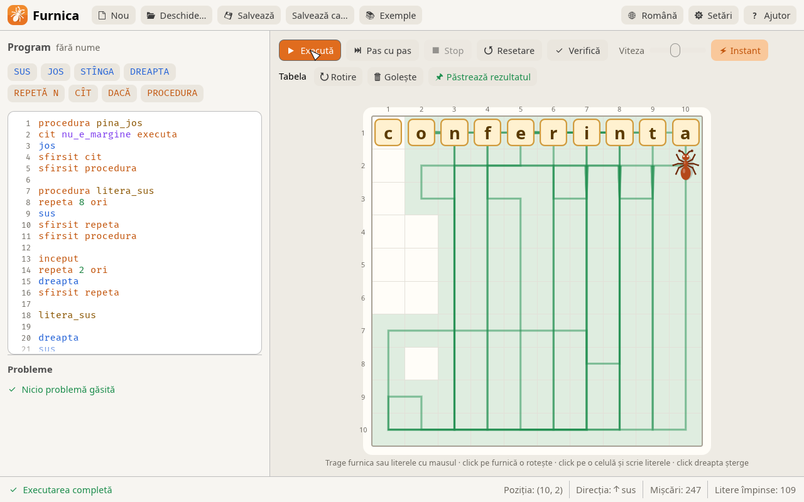
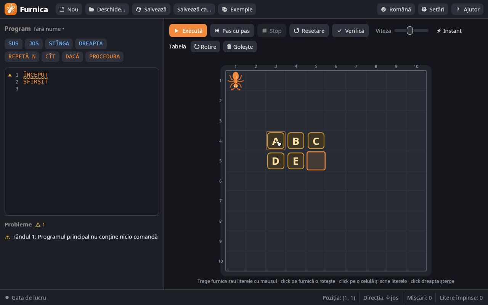
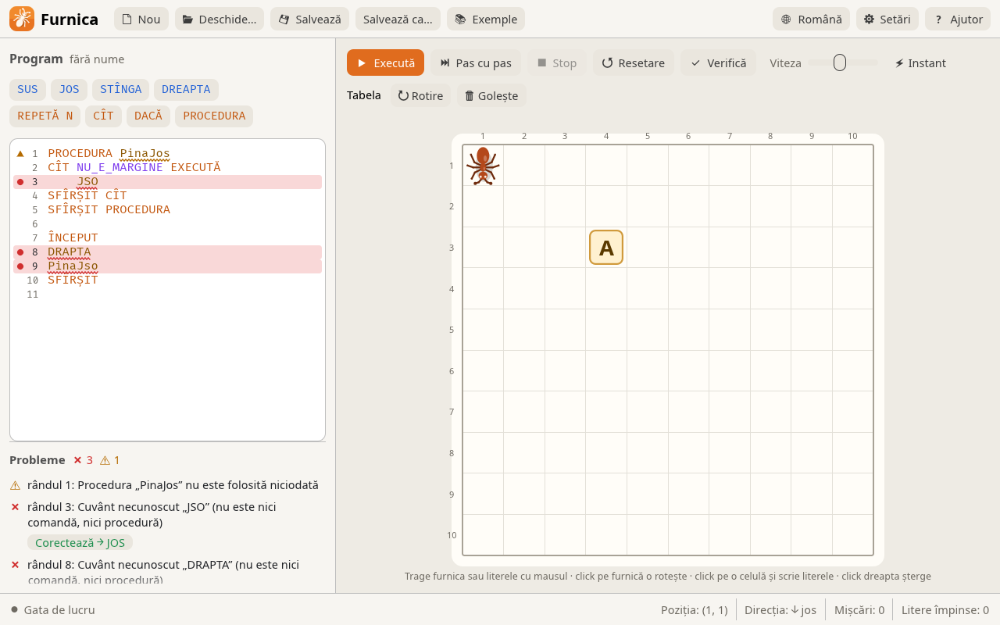

Furnica stă pe o tabelă cu litere. Elevul scrie un program cu comenzi simple — `SUS`, `JOS`, `STÎNGA`, `DREAPTA`, cicluri, condiții și proceduri — iar furnica îl execută pas cu pas, împingând literele din calea ei. Scopul: să aranjezi literele într-un cuvânt. Furnica 3 este rescrisă în Rust după programul original „Furnica” (Ant v2.00, 1999), iar fișierele `.ant` vechi se deschid și rulează fără modificări.



**[Descarcă Furnica](https://github.com/nazdravan/furnica/releases/latest)** · [Site-ul programului](https://nazdravan.github.io/furnica/) · [Cod sursă pe GitHub](https://github.com/nazdravan/furnica)

## Descărcare și instalare

Pe pagina [Releases](https://github.com/nazdravan/furnica/releases/latest) alege fișierul potrivit:

| Sistem | Fișier |
|---|---|
| Windows 10 / 11, 64 de biți | `furnica-<versiune>-windows-x64.msi` (instalator) sau `-windows-x64-portable.zip` |
| Windows 10 / 11, 32 de biți | `furnica-<versiune>-windows-x86.msi` sau `-windows-x86-portable.zip` |
| Windows 7 și 8 (32 și 64 de biți) | `furnica-<versiune>-windows7-x86-portable.zip` |
| macOS (Apple Silicon și Intel) | `furnica-<versiune>-macos-universal.dmg` |
| Ubuntu / Debian / Mint | `furnica-<versiune>-linux-x86_64.deb` |
| Orice Linux | `furnica-<versiune>-linux-x86_64.AppImage` |

- **Windows:** instalatorul `.msi` pune Furnica în meniul Start, iar fișierele `.ant` se deschid cu dublu-click. Varianta `.zip` nu cere instalare: dezarhivezi și pornești `Furnica.exe`.
- **macOS:** deschide `.dmg`-ul și trage `Furnica.app` peste *Applications*. Aplicația nu e semnată cu un certificat Apple, așa că la prima pornire: click dreapta → *Deschide* (pe macOS 15+: *Setări de sistem → Confidențialitate și securitate → Deschide oricum*).
- **Linux:** `sudo apt install ./furnica-*.deb` sau `chmod +x furnica-*.AppImage && ./furnica-*.AppImage`.

!!! tip "Un laborator întreg"
    Instalatorul se poate rula fără ferestre: `msiexec /i furnica-*.msi /qn`. Cu `INSTALLFOLDER="D:\Furnica"` alegi alt dosar, iar cu `DESKTOPSHORTCUT=""` nu se pune scurtătură pe desktop.

## Limbajul

| Comandă | Ce face |
|---|---|
| `SUS`, `JOS`, `STÎNGA`, `DREAPTA` | mută furnica cu o celulă; o literă din cale este împinsă |
| `ÎNCEPUT … SFÎRȘIT` | programul principal |
| `REPETĂ N ORI … SFÎRȘIT REPETĂ` | repetă de N ori |
| `CÎT condiție EXECUTĂ … SFÎRȘIT CÎT` | repetă cât timp condiția e adevărată |
| `DACĂ condiție ATUNCI comandă1 ALTFEL comandă2` | ramificare (`ALTFEL` poate lipsi) |
| `PROCEDURA nume … SFÎRȘIT PROCEDURA` | definește o procedură (înainte de `ÎNCEPUT`) |
| `nume` | apelează procedura |
| `// …` | comentariu |

Condiții: `E_MARGINE` (furnica privește spre marginea tabelei) și `NU_E_MARGINE`. Furnica privește în direcția în care s-a mișcat ultima dată.

Furnica nu poate ieși din tabelă, nu poate împinge o literă peste margine și nu poate împinge două litere aflate una după alta. În oricare din aceste cazuri programul se oprește cu eroare, iar locul e marcat cu roșu pe tabelă.

### Primul program

Furnica pornește din colțul din stânga-sus, iar litera `A` e în coloana 4, rândul 3. Programul o duce pe furnică deasupra literei, apoi împinge litera în jos:

```text
// Primul meu program: furnica împinge litera A
ÎNCEPUT
REPETĂ 3 ORI
    DREAPTA
SFÎRȘIT REPETĂ
REPETĂ 4 ORI
    JOS
SFÎRȘIT REPETĂ
SFÎRȘIT
```

### Proceduri și cicluri cu condiție

Exemplul „Margini” ocolește toată tabela, oricât de mare ar fi: fiecare procedură merge într-o direcție până la margine.

```text
PROCEDURA jos_pina_la_margine
    JOS
    CÎT NU_E_MARGINE EXECUTĂ
        JOS
    SFÎRȘIT CÎT
SFÎRȘIT PROCEDURA

PROCEDURA dreapta_pina_la_margine
    DREAPTA
    CÎT NU_E_MARGINE EXECUTĂ
        DREAPTA
    SFÎRȘIT CÎT
SFÎRȘIT PROCEDURA

// … la fel pentru sus și stînga

ÎNCEPUT
jos_pina_la_margine
dreapta_pina_la_margine
sus_pina_la_margine
stinga_pina_la_margine
SFÎRȘIT
```

### Cuvintele-cheie în trei limbi

Se pot scrie în oricare dintre limbi, cu sau fără diacritice (`INCEPUT`, `SFIRSIT`, `STINGA` merg la fel).

| Română | English | Русский |
|---|---|---|
| `SUS JOS STÎNGA DREAPTA` | `UP DOWN LEFT RIGHT` | `ВВЕРХ ВНИЗ ВЛЕВО ВПРАВО` |
| `ÎNCEPUT SFÎRȘIT` | `BEGIN END` | `НАЧАЛО КОНЕЦ` |
| `REPETĂ ORI` | `REPEAT TIMES` | `ПОВТОРИ РАЗ` |
| `CÎT EXECUTĂ` | `WHILE DO` | `ПОКА СДЕЛАЙ` |
| `DACĂ ATUNCI ALTFEL` | `IF THEN ELSE` | `ЕСЛИ ТОГДА ИНАЧЕ` |
| `PROCEDURA` | `PROCEDURE` | `ПРОЦЕДУРА` |
| `E_MARGINE NU_E_MARGINE` | `BORDER NOT_BORDER` | `КРАЙ НЕ_КРАЙ` |

## Editarea tabelei



- **Furnica** se mută prin tragere cu mausul, iar un click pe ea o rotește.
- **Literele** se scriu de la tastatură, ca într-un text: click pe o celulă și scrii, cursorul trece singur la celula următoare.
- Literele se mută prin tragere; trase în afara tabelei (sau cu click dreapta) se șterg.
- Tabela poate avea între 3 × 3 și 20 × 20 de celule.
- După rulare, tabela de pornire rămâne neschimbată; **Păstrează rezultatul** face din tabela obținută noua tabelă de pornire.

## Analizorul de cod



Programul este verificat la fiecare modificare, iar analizorul găsește toate greșelile, nu doar prima:

- cuvintele greșite sunt subliniate ondulat (roșu = eroare, galben = avertisment); la hover apare explicația;
- lista **Probleme** de sub editor arată toate erorile, iar un click duce cursorul la cuvântul respectiv;
- pentru cuvinte scrise greșit se propune corectura („Poate ați vrut DREAPTA?”), aplicabilă cu butonul **Corectează**;
- programul cu erori nu pornește; avertismentele (proceduri nefolosite, blocuri goale, cicluri `CÎT` care nu mută furnica) nu blochează rularea.

## Taste rapide

| Tastă | Acțiune |
|---|---|
| ++f5++ | execută / pauză |
| ++f6++ | pas cu pas |
| ++esc++ | stop |
| ++f7++ | verifică |
| ++ctrl+shift+f++ | formatează programul |
| ++ctrl+n++ / ++ctrl+o++ / ++ctrl+s++ | nou / deschide / salvează |

## Ce e nou față de versiunea originală

| | |
|---|---|
| **Interfață** | temă luminoasă și întunecată; interfața în română, rusă și engleză |
| **Furnica** | desenată vectorial, se rotește lin și își mișcă picioarele când merge |
| **Editor** | numerotarea rândurilor, evidențierea sintaxei, butoane care inserează comenzile, indentare automată |
| **Execuție** | animație fluidă, rândul curent evidențiat, drumul furnicii desenat pe tabelă; pas cu pas sau instant |
| **Blocuri** | se pot pune oricum unul în altul (în original `REPETĂ` nu putea conține alt `REPETĂ`) |
| **Tabela** | editată direct pe ea, între 3 × 3 și 20 × 20 de celule |

!!! info "Open-source"
    Furnica 3 este software liber, sub licența [GPL-3.0](https://github.com/nazdravan/furnica/blob/main/LICENSE). Codul sursă, istoricul modificărilor și raportarea problemelor — pe [GitHub](https://github.com/nazdravan/furnica).
